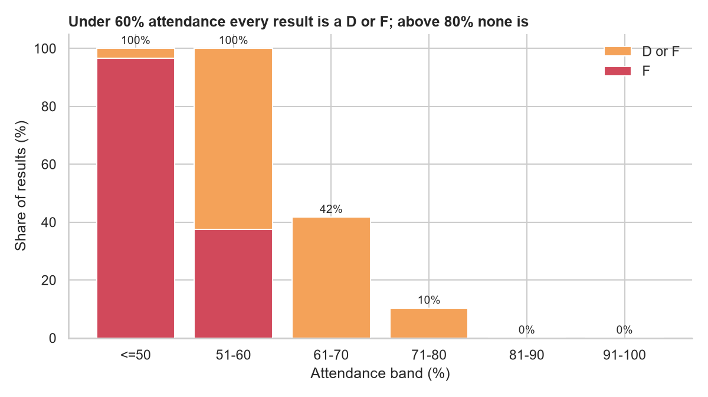
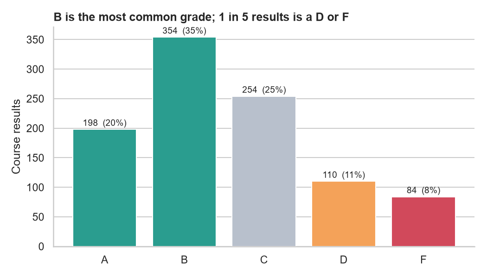
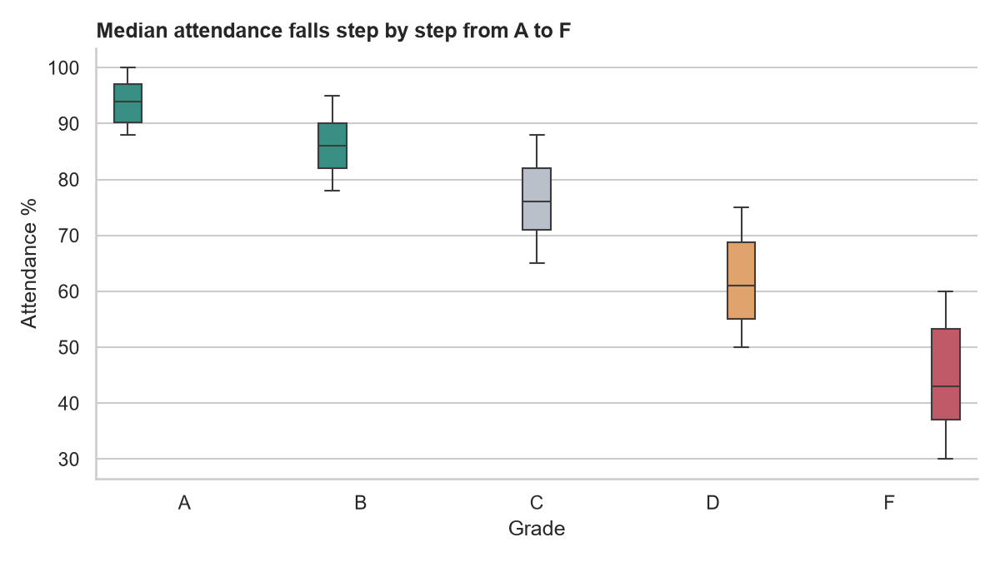
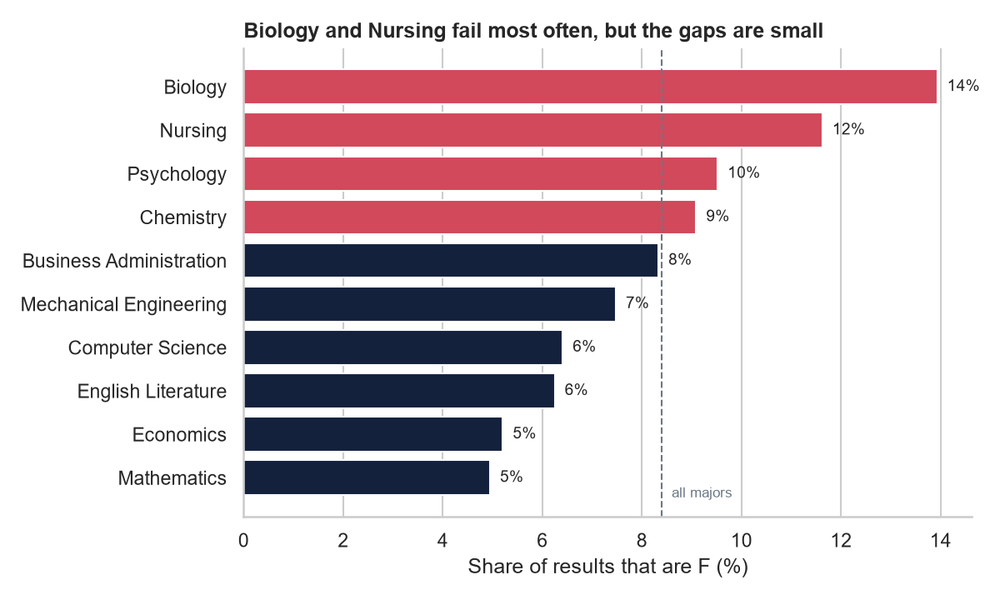
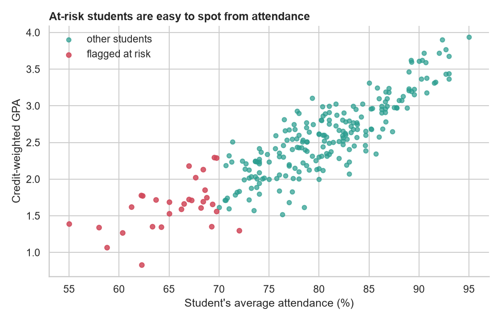

# Student Performance: Exploratory Data Analysis in Python

> Which course results end in a D or F, and how early can we see it coming? A reproducible pandas / seaborn / SciPy notebook with statistical tests and an early-warning rule.

[Azərbaycanca](README.md) · [Open the notebook](notebooks/student_performance_eda.ipynb)



## Question and data

1,000 course results of 244 students in 10 majors over 4 semesters (Fall 2023 to Spring 2025): major, course, credit hours, letter grade, grade points and attendance %. Sample data from my analytics course; `src/prepare_data.py` cleans it (student names are dropped, helper columns removed, six data-quality checks).

## Key findings

| Finding | Evidence |
|---|---|
| Attendance is the strongest signal | Spearman correlation with grade points 0.85; credit hours 0.01 |
| Failure is threshold-like | An F appears only at 60% attendance or below; every result at 60% or below is a D or F; above 80% there is no D or F |
| 1 in 5 results is a D or F | 19.4% D or F, 8.4% F |
| A simple rule flags the right students | Average attendance below 70% or two or more fails: 30 of 244 students (12%), credit-weighted GPA 1.64 vs 2.59 for the rest |
| Majors do not differ significantly | Chi-square p = 0.34, Kruskal-Wallis p = 0.48; Biology looks worst descriptively (fail rate 14%, lowest attendance) but this is not proven |
| Gender and credit hours do not matter | Mann-Whitney p = 0.59; 3 vs 4 credit courses have similar grades |
| Slow decline over time | Average grade points 2.55 (Fall 2023) to 2.35 (Spring 2025); attendance 80% to 78% |

## Charts

| | |
|---|---|
|  |  |
|  |  |

## Method

1. Data quality checks (missing values, duplicates, ranges, consistency of grade and grade points).
2. Univariate and bivariate analysis: distributions, box plots, attendance bands.
3. Hypothesis tests chosen for the data type: Spearman (ranked relationship), chi-square (fail rate by major), Kruskal-Wallis and Mann-Whitney (non-normal grade points).
4. Student-level aggregation with credit-weighted GPA and a transparent at-risk rule.

## Notes and limitations

- `grade_points` (called "GPA (Semester)" in the source file) is the grade point of a single course result and is fully determined by the letter grade, so it adds no information beyond the grade.
- Observational data: low attendance may be a symptom (illness, work, disengagement) as well as a cause.
- Sample course data, not a real university.
- Next steps for a real project: add prior GPA and course difficulty, fit a logistic-regression early-warning model, test an attendance intervention.

## How to run

```bash
pip install -r requirements.txt
python src/prepare_data.py "path/to/13 Student Performance.xlsx"   # optional, data/student_performance.csv is included
python src/build_notebook.py                                       # executes the notebook and refreshes images/
```

Or just open `notebooks/student_performance_eda.ipynb` (outputs are saved in it).

## Author

**Alyaz Cabbarova**, aspiring data analyst, Baku.
[LinkedIn](https://www.linkedin.com/in/alyaz-cabbarova-450a6140b) · alyazcbbrv@gmail.com · [GitHub](https://github.com/alyazcbbrv-byte)

MIT License.
