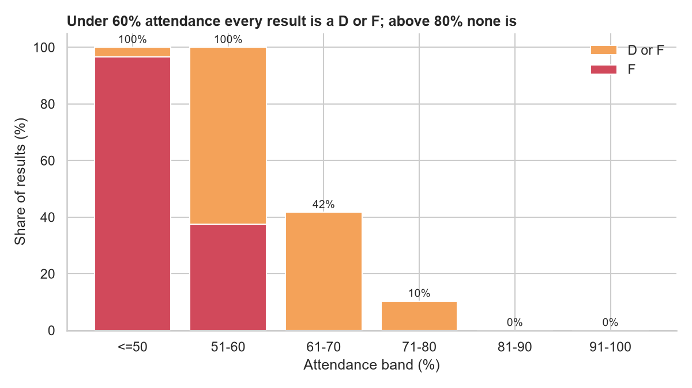
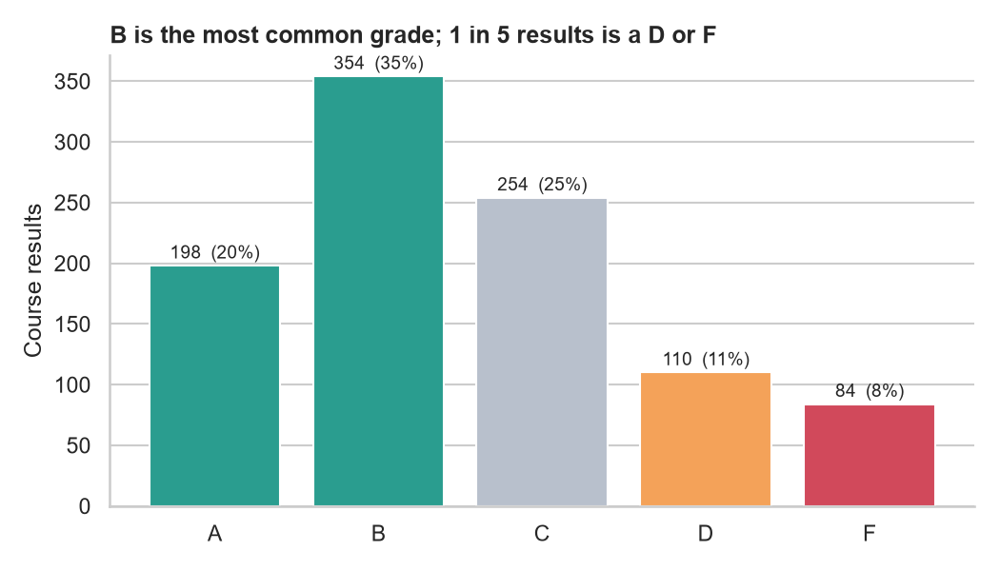
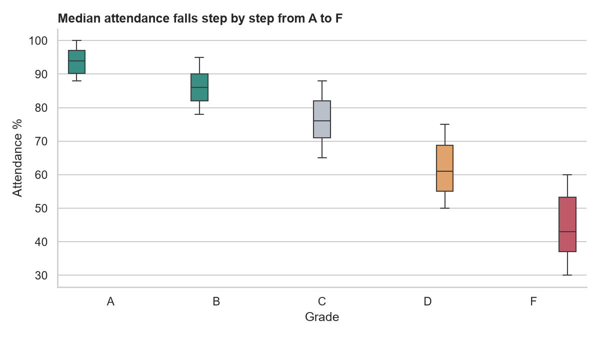
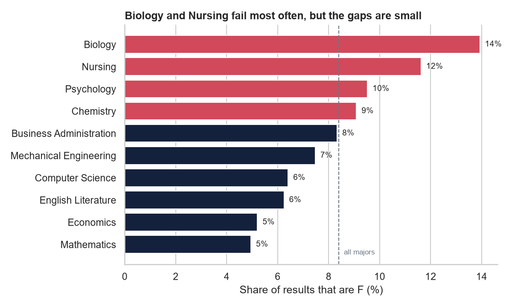
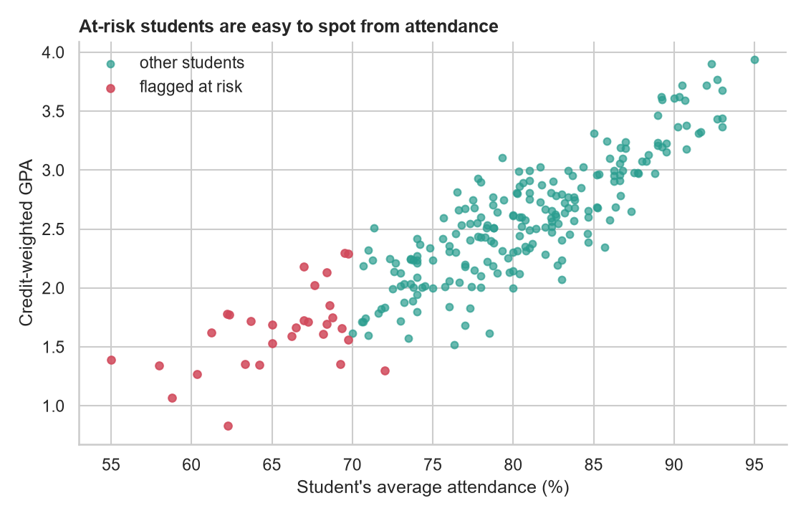

# Tələbə nəticələri: Python ilə kəşfiyyat data analizi (EDA)

> Hansı kurs nəticələri D və ya F ilə bitir və bunu nə qədər tez görmək olar? pandas / seaborn / SciPy ilə təkrarlana bilən notebook, statistik testlər və erkən xəbərdarlıq qaydası.

[English](README.en.md) · [Notebook](notebooks/student_performance_eda.ipynb)



## Sual və data

10 ixtisas, 244 tələbə, 4 semestr (Fall 2023-dən Spring 2025-ə) üzrə 1,000 kurs nəticəsi: ixtisas, kurs, kredit saatı, hərf qiyməti, bal və davamiyyət %. Analitika kursumdan nümunə datadır; `src/prepare_data.py` onu təmizləyir (tələbə adları silinir, köməkçi sütunlar çıxarılır, 6 keyfiyyət yoxlaması).

## Əsas nəticələr

| Tapıntı | Dəlil |
|---|---|
| Davamiyyət ən güclü siqnaldır | Balla Spearman korrelyasiyası 0.85; kredit saatı 0.01 |
| Uğursuzluq hədd xarakterlidir | F yalnız 60% və aşağı davamiyyətdə çıxır; 60% və aşağıda hər nəticə D və ya F-dir; 80%-dən yuxarıda D və F yoxdur |
| Hər 5 nəticədən 1-i D və ya F | 19.4% D və ya F, 8.4% F |
| Sadə qayda düzgün tələbələri tapır | Orta davamiyyət 70%-dən aşağı və ya 2+ F: 244 tələbədən 30-u (12%), kredit çəkili GPA 1.64, qalanlarda 2.59 |
| İxtisaslar arasında statistik fərq yoxdur | Chi-square p = 0.34, Kruskal-Wallis p = 0.48; Biologiya təsviri olaraq ən pis görünür (F payı 14%, ən aşağı davamiyyət), amma bu sübut olunmayıb |
| Cins və kredit saatı təsir etmir | Mann-Whitney p = 0.59; 3 və 4 kredit kurslarda qiymətlər oxşardır |
| Zamanla yavaş azalma | Orta bal 2.55-dən (Fall 2023) 2.35-ə (Spring 2025); davamiyyət 80%-dən 78%-ə |

## Qrafiklər

| | |
|---|---|
|  |  |
|  |  |

## Metod

1. Data keyfiyyəti yoxlamaları (boş dəyər, dublikat, aralıq, qiymət və balın uyğunluğu).
2. Paylanmalar, box plot, davamiyyət bantları.
3. Data tipinə uyğun testlər: Spearman, chi-square, Kruskal-Wallis, Mann-Whitney.
4. Tələbə səviyyəsində kredit çəkili GPA və şəffaf risk qaydası.

## Qeydlər və məhdudiyyətlər

- `grade_points` ("GPA (Semester)") tək kurs nəticəsinin balıdır və hərf qiyməti ilə tam müəyyən olunur, əlavə məlumat vermir.
- Müşahidə datasıdır: aşağı davamiyyət səbəb ola biləcəyi kimi simptom da ola bilər.
- Nümunə kurs datasıdır, real universitet deyil.

## Necə işlətməli

```bash
pip install -r requirements.txt
python src/build_notebook.py
```

## Müəllif

**Alyaz Cabbarova**, data analitik olmaq istəyən mütəxəssis, Bakı.
[LinkedIn](https://www.linkedin.com/in/alyaz-cabbarova-450a6140b) · alyazcbbrv@gmail.com · [GitHub](https://github.com/alyazcbbrv-byte)

MIT lisenziyası.
